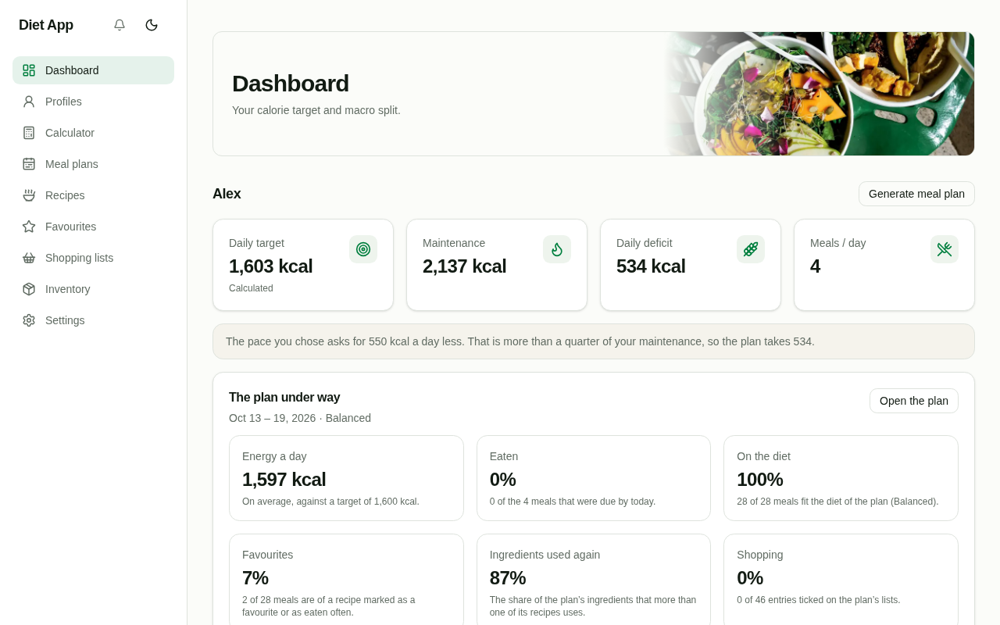
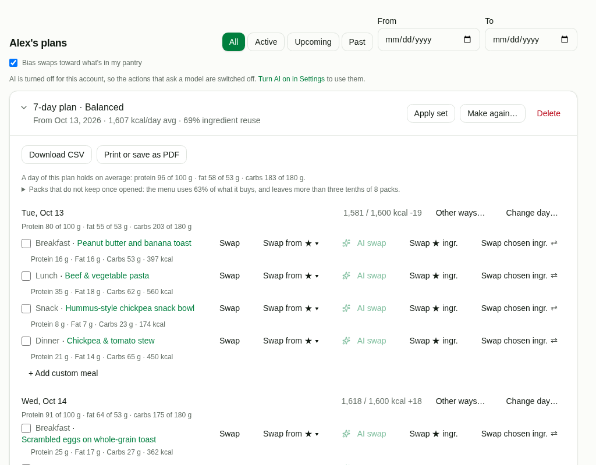
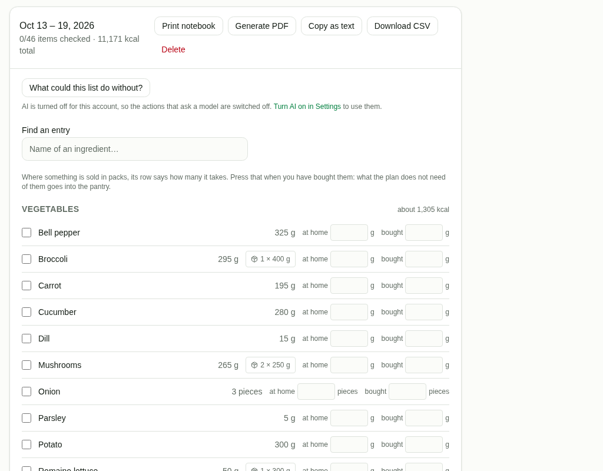
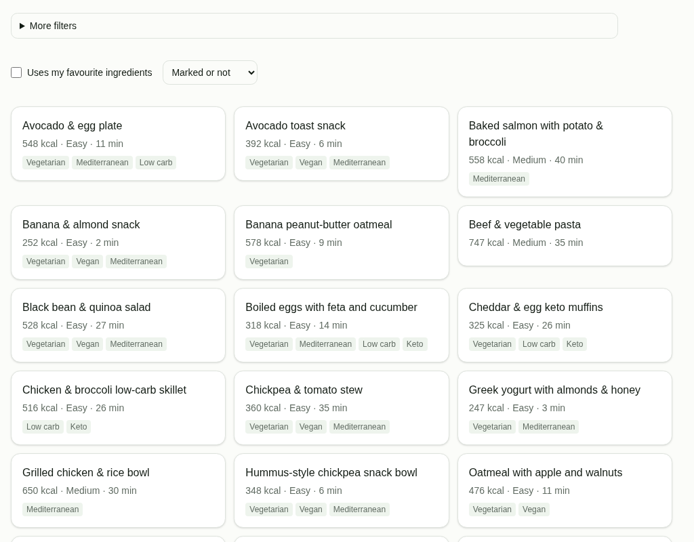

# Diet App

> Self-hostable diet & meal-planning platform with deterministic nutrition and BYOK AI.

[](LICENSE)
[](https://github.com/whiteravens20/diet-app/actions)
[](https://github.com/whiteravens20/diet-app/actions/workflows/codeql.yml)
[](https://scorecard.dev/viewer/?uri=github.com/whiteravens20/diet-app)

Diet App generates calorie-targeted meal plans, optimises ingredient reuse across a
planning window, and produces consolidated shopping lists — all from a **curated product
database** so every calorie and macro is deterministic and reproducible. AI is an optional
assistant: it drafts recipes, suggests substitutions and weighs what the planner proposes;
it never invents nutrition facts.

The companion Android app lives in a separate repository:
[`whiteravens20/diet-app-android`](https://github.com/whiteravens20/diet-app-android).

> [!WARNING]
> **Early development — not production ready.** Diet App is under active
> development. The API, data model and deployment story may change without
> notice, and the project has not had a security review. Self-host it to
> experiment, not for anything you depend on yet.

## Features

- **Profiles & calorie engine** — Mifflin-St Jeor BMR, activity multipliers, weekly
  weight-loss targets (0.25–1.0 kg/wk) converted to a daily deficit of at most a quarter
  of maintenance, a floor no calculated target goes under, manual override.
- **Meal planning** — multi-day plans honouring calorie/macro targets and diet type, with
  an optimiser that leans towards using up what it opens: a plan says what it buys in
  packs that do not keep against what it uses of them, and a plan made for cooking ahead
  has a dish cooked once for two days. A day of a plan under way can be set apart (a
  training or rest day, skipped, another number of meals, a target of its own), with what
  that does to its meals said before it is saved.
- **Recipes from a curated DB** — deterministic nutrition; AI may draft recipes only from
  approved ingredients, then a validation layer recomputes every number. A user can also
  write recipes of their own by hand from the catalogue's ingredients, and the engine works
  out what a serving holds. An operator can also take recipes in from a schema.org document
  they have: each line has to be an amount
  of an ingredient the catalogue knows, a person approves every draft, and the recipe says
  where it is from and under which licence.
- **Shopping lists and a pantry** — merged and category-grouped, counted the way one
  shops (eggs and slices of bread in pieces, weights rounded up to 5 g, the packs a row
  takes), with what the pantry already holds taken off, what was bought beyond the need
  put into it, and a way out of the application: a PDF, a table for a spreadsheet, a text
  to send.
- **Readable without a network** — over https the browser keeps the pages and the plans
  and lists that were read last; a row ticked in a shop without a signal is sent when the
  signal is back.
- **Your data leaves with you** — a plan as a table or on paper, and everything an account
  holds as one JSON file.
- **Meal & ingredient swapping** — random/favorite meal swaps and ingredient substitutions
  that preserve calories and report the macro delta.
- **Proposals to choose from** — other ways to fill a day, swaps that use up an opened
  pack, and what a shopping list could do without: worked out by the planner, and put in
  order with a sentence on each by a model when the account has one and is asked.
- **BYOK AI** — per-user OpenAI / Anthropic / OpenRouter / Ollama keys with failover, and a
  full deterministic fallback so the app works with **no AI key at all**. An operator can
  also lend the instance's own provider: to the accounts they approve, by default, within a
  monthly limit for each account, a smaller one for new accounts together and one for the
  whole instance.
- **Self-hosted, Docker-first** — `docker compose up` boots the whole stack.

## What it looks like

|                                                                                                                                            |                                                                                                                              |
| ------------------------------------------------------------------------------------------------------------------------------------------ | ---------------------------------------------------------------------------------------------------------------------------- |
|  |  |
|                                   |              |

The pictures are of an instance installed from this repository, with the catalogue it ships.

## Architecture

Diet App is one image started in several roles, plus PostgreSQL. The web front-end is a Next.js server and the only thing a browser talks to: it renders the pages and passes every `/api` request on to the API over the internal network, so there is a single origin and no CORS to configure. The API is a NestJS service that validates each request against schemas it shares with the web, checks who owns what, and runs the planning logic. A worker runs the scheduled tasks from the same code, and a one-shot job applies database migrations before either of them starts.

Every calorie and macro comes from one place. The curated ingredient database is the source of truth, and a deterministic engine inside the API computes nutrition, meal plans, shopping lists and substitutions from it as pure functions, so the same inputs always give the same numbers. AI is optional and never writes nutrition. When a user brings their own provider key, the model is asked only for the structure of a recipe, built from the ingredients it was given; a validation layer then rejects anything it does not know and recomputes every number from the database. With no key at all, the app runs on the engine alone.

PostgreSQL holds the accounts, profiles, plans and the curated data. E-mail addresses and AI provider keys are stored encrypted and passwords hashed. A provider key is used inside the API to call the provider its owner chose, and is never sent back to the browser.

## Install

```bash
git clone https://github.com/whiteravens20/diet-app
cd diet-app
sh scripts/init-env.sh        # writes .env with freshly generated secrets
```

## Run

Docker (recommended):

```bash
docker compose -f infra/docker-compose.dev.yml up --build
```

Local (Node 24 LTS):

```bash
npm install
npm run db:migrate
npm run dev
```

Web app → `http://localhost:3000`, API → `http://localhost:4000`.

## Production deploy (pre-built images)

For deploying to a server you do **not** need the repo or a build toolchain.
The official image is published to GHCR and consumed by a self-contained
compose file at [`infra/docker-compose.prod.yml`](infra/docker-compose.prod.yml):

- `ghcr.io/whiteravens20/diet-app:latest` — one image for the HTTP API, the
  scheduled-tasks worker, the migration job and the Next.js frontend; each
  service starts it with its own command

There is no release yet, so there is no `latest` tag either. Until the first
release, set `IMAGE_TAG=edge` in `.env` to run the release candidate built from
`main`, or `IMAGE_TAG=edge-<7-char-sha>` to hold one build of it.

On the target server:

```bash
mkdir diet-app && cd diet-app

# 1. Grab the compose file and an env template.
curl -O https://raw.githubusercontent.com/whiteravens20/diet-app/main/infra/docker-compose.prod.yml
curl -o .env https://raw.githubusercontent.com/whiteravens20/diet-app/main/.env.example

# 2. Fill in secrets (POSTGRES_PASSWORD, JWT_*, *_ENCRYPTION_SECRET,
#    ADMIN_PASSWORD, APP_URL/API_URL pointing at your public origin).
#    Generate each secret with: openssl rand -hex 32
nano .env

# 3. Your terms of service, shown at /terms: start from the template
#    (and terms/TOS.pl.md beside it for Polish readers).
mkdir terms
curl -o terms/TOS.md https://raw.githubusercontent.com/whiteravens20/diet-app/main/terms/TOS.md
nano terms/TOS.md

# 4. Pull and start.
docker compose -f docker-compose.prod.yml pull
docker compose -f docker-compose.prod.yml up -d
```

Until you write your own terms, the page shows the template with a note that it is one.
Under them the page always shows the software's licence notices and your
`OPERATOR_CONTACT`; see [Terms of service](docs/ops/deployment.md#terms-of-service).

The web app listens on `127.0.0.1:3000` of the host and passes every `/api`
request on to the API, which is reached only inside the stack. Put your own
reverse proxy (Traefik / Caddy / nginx) in front of it and terminate TLS there.

**Updating** — re-pull and restart; migrations apply automatically on boot:

```bash
docker compose -f docker-compose.prod.yml pull
docker compose -f docker-compose.prod.yml up -d
```

**Pinning a version** — `latest` follows the production release channel; set
`IMAGE_TAG=<release-tag>` in `.env` to pin the whole application to a
known-good version and bump manually after testing.

**Local self-hosted AI** — start with `--profile ollama` to add an Ollama
service on the same host; set `AI_DEFAULT_PROVIDER=ollama` and
`OLLAMA_BASE_URL=http://ollama:11434` in `.env`. Pull a model after boot:
`docker compose exec ollama ollama pull llama3.1:8b`.

After first boot, follow [First-run](#first-run-populate-the-curated-database)
below to populate the curated ingredient database from the admin panel.

## First-run: populate the curated database

The stack starts with an empty catalogue: starting it only brings the database
to the current schema. Loading the curated data (the ingredients and recipes of
[`data/`](data/README.md), with what a food import and the curation queue added)
is something an administrator does, in the panel:

1. Set `ADMIN_PASSWORD` in `.env` (and optionally `ADMIN_USER`, defaults to `admin`).
2. (Optional) Run the USDA importer to add public-domain whole foods:
   ```bash
   FDC_API_KEY=<key> npm run import:usda
   ```
   Defaults to USDA **Foundation**: about 330 clean generic foods, some 270 of
   which the catalogue does not hold already. Without an importer run, only the
   hand-curated baseline (93 ingredients) seeds. See
   [data/README.md](data/README.md#choosing-fdc_data_types) before enabling
   `SR Legacy` — it adds ~7 k entries, but most are brand names or cuts of one
   animal: every one of them is put before the model that drafts recipes, and
   the catalogue update takes minutes where it took seconds.
3. Open <http://localhost:3000/admin>, sign in, click **Update Database**.

The admin panel surfaces ingredient/recipe/substitution counts and a
data-hash check so subsequent edits or re-imports show "update available"
without any guessing. User accounts and plans are preserved across updates.

The CLI alternative is `npm run db:seed`. See
[docs/ops/deployment.md](docs/ops/deployment.md) for production and GPU/Ollama setups.

## Where the recipes come from

The repository holds a fixed base of 131 reviewed recipes, in `data/recipes.json` and
`data/recipes/` (see [data/README.md](data/README.md)). Every instance starts from it, and
it changes only in this repository.

Beyond that base an instance grows a library of its own, in its database. Its administrator
has the instance's model write recipes or takes them in from a document; its users write
recipes by hand or have a model write them, and send them in; a recipe the instance's model
writes for a user goes in by itself. Each becomes a recipe of the instance's library only
once people have approved it in the curation queue, and none of them comes back to this
repository. [docs/ops/curation-shipping.md](docs/ops/curation-shipping.md) says how approved
recipes ship and how to keep a copy of what an instance added.

## Documentation

- [docs/ops/deployment.md](docs/ops/deployment.md) — Docker, self-hosting, Ollama
- [docs/ops/env-reference.md](docs/ops/env-reference.md) — every environment variable
- [docs/ops/ai-models.md](docs/ops/ai-models.md) — model recommendations by surface and hardware tier
- [docs/api/](docs/api/README.md) — the contract of the API: an OpenAPI description, the list of routes, the codes a request is refused with
- [docs/ops/curation-shipping.md](docs/ops/curation-shipping.md) — how approved drafts ship, taking recipes in from elsewhere, filling a language recipes lack, backing up what an instance added, moving to a new server

The product specification and the architecture and design documents are not
published while the project is in development; they join the repository with
v1.0.0.

## Contributing

See [CONTRIBUTING.md](CONTRIBUTING.md) and the [Code of Conduct](CODE_OF_CONDUCT.md).

## Security

See [SECURITY.md](SECURITY.md) for the disclosure policy.

## Credits

The photographs of the pages are by their authors, under the licences named in
[apps/web/public/imagery/CREDITS.md](apps/web/public/imagery/CREDITS.md). The printed
shopping list is set in [Inter](https://rsms.me/inter/) by The Inter Project Authors,
under the SIL Open Font License 1.1; its files and the licence text are in
[apps/web/public/fonts/](apps/web/public/fonts/).

## How the code is written and checked

Diet App is built using AI coding tools. The tools write most of the code, tests and
documentation; the maintainer decides what gets built and is responsible for everything
that lands here. The project relies on checks that anyone can inspect, and before the
first release is published, a group of human testers will try the release candidate at
the maintainer's request. The project is in early development: there is no release yet
and no independent security review.

**What a change goes through**

- Every push and pull request to `dev` and `main` checks that every file is laid out as
  Prettier writes it, runs lint with no warnings allowed, type checking, a build, and the unit and integration tests of the API and of the web app, the
  integration tests against PostgreSQL, with coverage floors that fail the run when they
  are not reached. The same run checks that the database migrations match the schema, that
  no export, file or dependency goes unused, that the curated data in `data/` can be
  seeded, and that the API stays within its budgets of time and of database statements on
  a catalogue of 2,000 recipes. Another job builds the stack, starts it from a freshly
  generated `.env`, runs the browser tests against it and checks that a start on the
  unedited template is refused; the links between the documents and the shell scripts are
  checked as well ([test.yml](.github/workflows/test.yml)).
- A change of the API, of the package it shares with the web app or of the contract in
  `docs/api/` is also checked against the [Android
  client](https://github.com/whiteravens20/diet-app-android): every call of the client is
  held to the contract the change publishes, and the run fails when one no longer fits
  ([android-client.yml](.github/workflows/android-client.yml)).
- CodeQL, `npm audit`, package signature checks and Trivy scans of the repository and of
  the image run on every push and pull request, and again every week. Every action a
  workflow uses is pinned to a commit: a run fails when a pin is not the commit its version
  tag names, and the pinned versions are looked up in GitHub's advisory database
  ([codeql.yml](.github/workflows/codeql.yml),
  [security.yml](.github/workflows/security.yml)).
- On a pull request, a dependency review fails when the change brings in a dependency
  with a known high-severity vulnerability, or one whose licence is not on the list of
  licences that combine with AGPL-3.0 ([security.yml](.github/workflows/security.yml)).
- The jobs of [test.yml](.github/workflows/test.yml) are required checks on `dev` and
  `main`, and on `main` so are CodeQL, `npm audit` and both Trivy scans: a pull request is
  merged only when they pass.
- The image a release candidate is tested from is built from `main` and pushed by its
  digest alone; it gets its tags only after its scan passed, and a high or critical
  finding stops it ([docker-snapshot.yml](.github/workflows/docker-snapshot.yml)).
- Commits are signed, and the [OpenSSF
  Scorecard](https://scorecard.dev/viewer/?uri=github.com/whiteravens20/diet-app)
  results are public.

**What the maintainer decided and read**

- Nutrition never comes from a language model. The maintainer specified that every
  calorie and macro is computed by the engine in `apps/api/src/engine` from the curated
  database. A model may only draft the structure of a recipe, and a validation layer
  then recomputes every number.
- Each engine module has its own unit tests.
- `apps/api/src/common/crypto.ts` and `apps/api/src/auth/auth.service.ts` (e-mail
  encryption, password peppering, blind-index lookups) are read line by line by the
  maintainer whenever they change.

If something looks wrong, open an issue. For a vulnerability, follow
[SECURITY.md](SECURITY.md).

## License

[GNU Affero General Public License, version 3](LICENSE) (AGPL-3.0-only), with one
additional term in [NOTICE](NOTICE) — © 2026 White Ravens.

You are free to self-host, change and share Diet App. If you run a changed version for
other people, the licence requires you to offer them its source code, and every copy has
to keep the attribution "Diet App by White Ravens" together with the address of this
repository.
